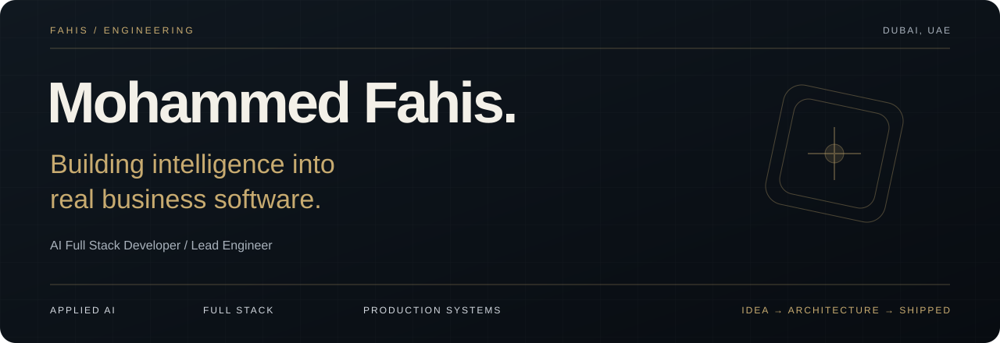
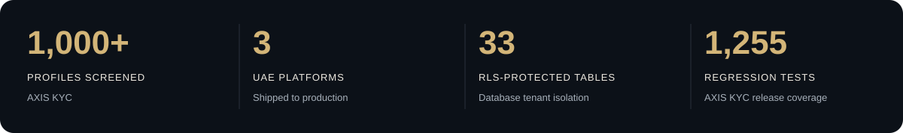
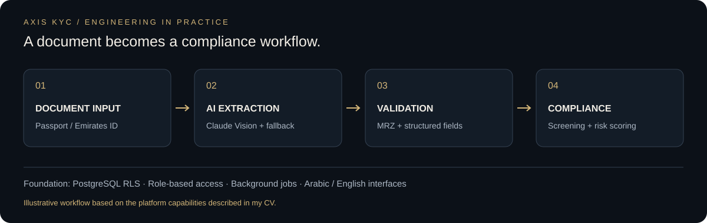

 

**AI FULL STACK DEVELOPER · LEAD ENGINEER · DUBAI, UAE**

I turn complex business workflows into production software — with AI where it makes a difference.

[Portfolio](https://fahis7.github.io/Fahis-portfolio/) &nbsp; / &nbsp; [LinkedIn](https://www.linkedin.com/in/mohammed-fahis-mt/) &nbsp; / &nbsp; [Email](mailto:muhdfahis.aidev@gmail.com) &nbsp; / &nbsp; [GitHub](https://github.com/Fahis7)

 

---
x
## From business problem to working product.

I'm **Mohammed Fahis**, an AI Full Stack Developer and Lead Engineer based in Dubai. I build across the full product lifecycle: data models, APIs, interfaces, AI workflows, infrastructure, and deployment.

My work spans **compliance, property management, recruitment, and e-commerce**. The common thread is making complex operations easier to run: extracting identity data from documents, searching business knowledge, matching candidates to roles, and building the systems around those capabilities.

Currently, I lead engineering at **AM Audit — Abdulla Al Mulla Auditing & Accounting**, where I designed, built, and deployed **AXIS KYC**, a multi-tenant AML/KYC platform used across multiple UAE compliance firms.

> The AI feature is one part of the product. I build the permissions, data isolation, background jobs, and user experience that make it usable.

## 01 / Flagship work

### AXIS KYC
**Multi-tenant AML/KYC compliance platform · Sole Engineer / Lead Engineer**

[Visit platform ↗](https://app2.axiskyc.ae)

A compliance platform that brings identity verification, sanctions screening, risk assessment, training, and audit workflows into one system.

| Engineering challenge | What I built |
| :--- | :--- |
| Keep each firm's data isolated | PostgreSQL Row-Level Security across **33 tables**, with **three database roles** for structural tenant isolation. |
| Support different compliance responsibilities | **Four role-based portals** for Organisation, Admin, Broker, and External Compliance Officer, including multi-company access and JWT tenant switching. |
| Reduce manual identity entry | Passport and Emirates ID extraction with **Claude Vision**, forced tool use, **Tesseract fallback**, and **MRZ validation** — extracting **nine fields in 4–7 seconds**. |
| Connect screening and risk workflows | Sanctions.io integration, sanctions and PEP checks, the UAE Local Terrorist List, AI-assisted adverse media analysis, and a **six-factor weighted risk engine**. |
| Strengthen release confidence | Addressed a **16-finding pre-launch security audit**, backed by **1,255 regression tests**, in-memory JWT handling, transaction atomicity, idempotency guards, and rate limiting on paid API endpoints. |
| Support day-to-day compliance operations | EDD workflows, audit document management, AI quizzes inside training videos, QR-verifiable certificates, and bilingual PDF generation. |

**Impact:** 1,000+ screened profiles across multiple UAE compliance firms.

`Python` `Django / DRF` `PostgreSQL RLS` `Next.js 16` `React 19` `TypeScript` `Tailwind CSS` `Claude Vision` `Celery` `Redis` `Docker` `GitHub Actions`

### PropAI OS
**AI-powered property management · Full Stack AI Developer · Zero Accounting, Dubai**

[Explore project ↗](https://propai-os.up.railway.app)

Built a multi-tenant property management product with three AI workflows connected to everyday operations:

- **Photo → maintenance ticket:** Llama 4 Vision analyses damage, assigns priority, and drafts the ticket.
- **Market data → rent guidance:** Llama 3.3 70B supports rental benchmarking with confidence scores.
- **Property knowledge → answers:** A RAG concierge uses pgvector retrieval to answer questions about leases, payments, and building rules.

The surrounding system includes **four portals, eight authentication roles, asynchronous jobs, and five Docker Compose services**.

`Django 5` `React 19` `Groq` `Llama 4 Vision` `Llama 3.3 70B` `pgvector` `Celery` `Redis` `Docker` `Railway`

### Seek & Sync
**HR consultancy platform · Frontend Developer & AI Integration · Abu Dhabi**

[Explore project ↗](https://seek-and-sync.netlify.app)

Shipped a recruitment platform connecting a polished candidate experience with AI-assisted recruiter workflows.

- **CV parsing:** Claude Haiku extracts structured candidate information from uploaded CVs.
- **Semantic matching:** Embeddings stored in Supabase support matching candidates to vacancies.
- **Recruiter updates:** Resend delivers automated alerts with AI-written summaries, supported by unread badges and WhatsApp contact actions.

`Next.js 14` `TypeScript` `Tailwind CSS` `Claude Haiku` `Supabase` `pgvector` `Resend` `Netlify`

<strong>Also built: Horologie — full-stack e-commerce</strong>

 

[Explore project ↗](https://horologiee.vercel.app)

Built a luxury e-commerce platform with JWT and Google OAuth authentication, Firebase MFA, Cloudinary media delivery, and a real-time analytics dashboard powered by Django ORM aggregations.

`Django REST Framework` `React` `PostgreSQL` `Firebase MFA` `Google OAuth` `Cloudinary`

## 02 / Experience

| When | Role & organisation | Focus |
| :--- | :--- | :--- |
| **2026–Present** | **AI Full Stack Developer / Lead Engineer** · AM Audit, UAE | Sole engineering ownership of AXIS KYC, from architecture to production. |
| **May–Jun 2026** | **Full Stack AI Developer** · PropAI OS / Zero Accounting, Dubai | Vision AI, rental intelligence, RAG, and multi-tenant property workflows. |
| **Feb–Apr 2026** | **Frontend Developer & AI Integration** · Seek & Sync, Abu Dhabi | Recruitment experience, CV parsing, semantic matching, and recruiter automation. |
| **Apr 2025–Jan 2026** | **Full Stack Developer Intern** · Bridgeon Solutions LLP, Kerala | Django APIs, authentication, AWS deployment, and GitHub Actions delivery pipelines. |

## 03 / Engineering toolkit

| Area | Technologies & capabilities |
| :--- | :--- |
| **Applied AI** | Claude Vision & Haiku · Groq / Llama · OpenAI · RAG · Embeddings · Semantic retrieval · Document OCR · MRZ validation |
| **Backend** | Python · Django · Django REST Framework · FastAPI · REST APIs · Celery · Redis · Webhooks |
| **Frontend** | TypeScript · JavaScript · React · Next.js App Router · Tailwind CSS · SWR · Arabic RTL · Bilingual interfaces |
| **Data & access** | PostgreSQL · Row-Level Security · pgvector · Supabase · Multi-tenancy · RBAC · JWT · OAuth2 |
| **Delivery & operations** | Docker · Docker Compose · GitHub Actions · AWS EC2 / RDS · DigitalOcean · Railway · Vercel · Nginx · Gunicorn · Sentry |

<strong>What I care about when building</strong>

 

- **Data boundaries:** tenant isolation belongs in the database as well as the application.
- **Practical AI:** connect model output to a useful workflow, with validation and fallbacks.
- **Reliable operations:** protect repeated actions with idempotency and keep slow work in background jobs.
- **Complete experiences:** support the people using the product through clear interfaces, role-aware access, and bilingual workflows.
- **Release confidence:** use regression coverage and security review to support changes in production.

## 04 / Foundation

**Bachelor of Computer Application** · Calicut University · 2022–2025  
**One Million Prompters — Dubai** · Selected for the Dubai Future Foundation programme · 2025  
**Python Fullstack Developer Certification** · Django · DRF · React

**Languages:** English · Malayalam

---

### Have a complex workflow worth simplifying?

I'm interested in **AI engineering, full-stack development, and SaaS product engineering** opportunities.

**[Let's talk →](mailto:muhdfahis.aidev@gmail.com)** &nbsp; · &nbsp; [WhatsApp](https://wa.me/971542894979)

[LinkedIn](https://www.linkedin.com/in/mohammed-fahis-mt/) &nbsp; · &nbsp; [Portfolio](https://fahis7.github.io/Fahis-portfolio/) &nbsp; · &nbsp; Dubai, UAE

 

Built around real workflows. Designed for the people who use them.

