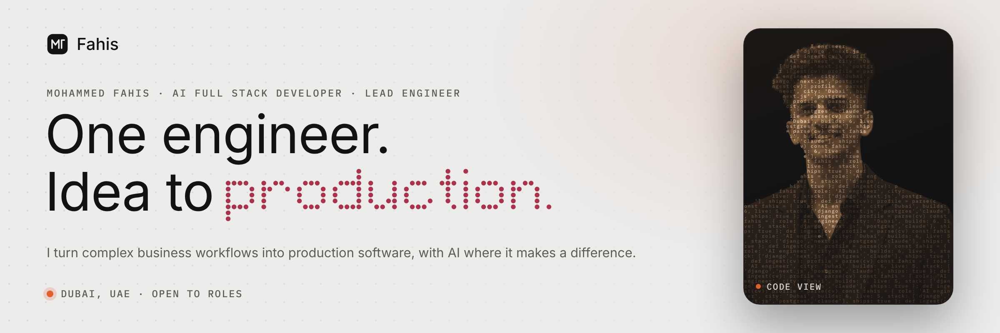
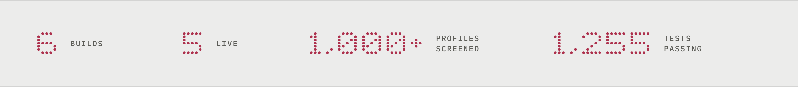
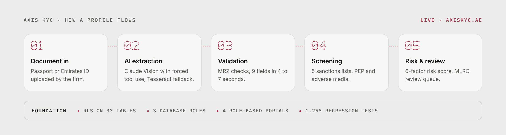
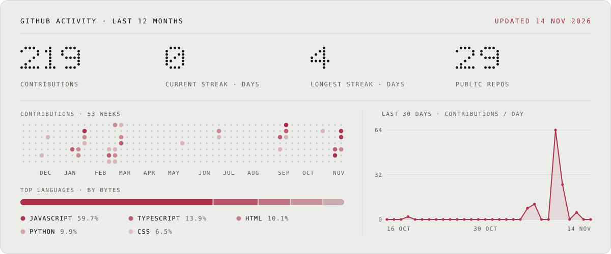

<picture>
  <source media="(prefers-color-scheme: dark)" srcset="./assets/banner-dark.png">
  
</picture>

[Portfolio](https://fahis7.github.io/Fahis-portfolio/) &nbsp;·&nbsp; [LinkedIn](https://www.linkedin.com/in/mohammed-fahis-mt/) &nbsp;·&nbsp; [Email](mailto:muhdfahis.aidev@gmail.com) &nbsp;·&nbsp; [WhatsApp](https://wa.me/971542894979) &nbsp;·&nbsp; [CV](https://fahis7.github.io/Fahis-portfolio/cv.html)

<picture>
  <source media="(prefers-color-scheme: dark)" srcset="./assets/impact-dark.png">
  
</picture>

 

I'm **Mohammed Fahis**, an AI Full Stack Developer and Lead Engineer in Dubai. I own products end to end: data models, APIs, interfaces, AI workflows and deployment.

Right now I lead engineering at **AM Audit**, where I designed, built and shipped **AXIS KYC**, a multi-tenant AML/KYC platform used by UAE compliance firms.

> The model suggests. A human decides. I build the permissions, data isolation and workflows that make AI usable in serious software.

 

## 01 · Work

### AXIS KYC &nbsp;`LIVE` · Sole engineer · AM Audit

Multi-tenant compliance SaaS for UAE firms: identity extraction, sanctions screening, risk scoring, MLRO review, training and audit in one system. &nbsp;[**axiskyc.ae ↗**](https://axiskyc.ae)

<picture>
  <source media="(prefers-color-scheme: dark)" srcset="./assets/axis-flow-dark.png">
  
</picture>

| Challenge | What I built |
| :--- | :--- |
| Keep each firm's data apart | PostgreSQL Row-Level Security on **33 tables** with **3 database roles** |
| Different jobs, one platform | **4 role-based portals**, multi-company access and JWT tenant switching |
| No more manual ID entry | Claude Vision OCR with Tesseract fallback and MRZ checks: **9 fields in 4 to 7 s** |
| Screening that holds up | **5 sanctions lists**, PEP and adverse media, plus a **6-factor risk engine** |
| Safe to ship | **16-finding security audit**, all fixed, backed by **1,255 regression tests** |

`Django / DRF` `PostgreSQL RLS` `Next.js` `React 19` `TypeScript` `Claude Vision` `Celery` `Redis` `Docker` `GitHub Actions`

 

### RefurbOps &nbsp;`LIVE` · Independent product

Tracks used phones and laptops from intake to sale, and sells each unit on several marketplaces without overselling. &nbsp;[**Live ↗**](https://refurbops.vercel.app)

- Oversell-safe sync across **3 marketplaces**: first order wins, the unit delists everywhere
- AI photo grading and a plain-English ops assistant, with a human making the call
- IMEI intake with TAC lookup and Luhn check, **150+ tests** and CI on every push

 

### PropAI OS &nbsp;`DEMO OFFLINE` · Abu Dhabi

Multi-tenant property SaaS: four role-based portals, async jobs and five Docker services.

- **Photo to ticket:** Groq Llama 4 Vision triages maintenance photos and routes the job
- **Market data to rent price:** smart pricing on live market data
- **Documents to answers:** a RAG concierge on pgvector and Llama 3.3 70B

`Django 5` `React 19` `PostgreSQL` `pgvector` `Groq` `Celery` `Redis` `Docker` `Railway`

 

### More builds

| Project | What it is | Stack |
| :--- | :--- | :--- |
| [**Zero Accounting ↗**](https://zeroaccounting.ae) | Live bilingual English/Arabic site for an FTA-approved tax firm in Abu Dhabi | `React` `Vite` `react-i18next RTL` `Framer Motion` `Vercel` |
| [**Seek & Sync ↗**](https://seek-and-sync.netlify.app) | Live recruiting platform: Claude Haiku CV parsing and semantic job matching | `Next.js 14` `TypeScript` `Supabase` `pgvector` `Netlify` |
| [**Horologie ↗**](https://horologiee.vercel.app) | Luxury watch store with three-layer auth and a live analytics dashboard | `Django REST` `React` `PostgreSQL` `Firebase MFA` `Cloudinary` |

 

## 02 · Experience

| When | Role | Focus |
| :--- | :--- | :--- |
| **2026 to now** | **AI Full Stack Developer / Lead Engineer** · AM Audit, UAE | Sole engineer of AXIS KYC, from architecture to production |
| **Nov 2026** | **AI Full Stack Developer** · RefurbOps, Dubai | Independent product: AI grading, ops assistant, marketplace sync |
| **Jun 2026** | **Frontend Developer** · Zero Accounting, Abu Dhabi | Bilingual site with full RTL, mobile first |
| **May to Jun 2026** | **Full Stack AI Developer** · PropAI OS, Abu Dhabi | Vision AI, rent pricing and a RAG concierge |
| **Feb to Apr 2026** | **Frontend Developer & AI Integration** · Seek & Sync, Abu Dhabi | CV parsing, vector matching and recruiter alerts |
| **2025** | **Full Stack Developer** · Horologie | E-commerce built from scratch, auth and analytics |

 

## 03 · Toolkit

| Area | Tools |
| :--- | :--- |
| **Applied AI** | Claude Vision & Haiku · Groq / Llama · RAG · Embeddings · pgvector · Document OCR · MRZ validation |
| **Backend** | Python · Django · DRF · FastAPI · Celery · Redis · Webhooks · Microservices |
| **Frontend** | TypeScript · React · Next.js · Vite · Tailwind CSS · Framer Motion · Arabic RTL |
| **Data & access** | PostgreSQL · Row-Level Security · Supabase · Multi-tenancy · RBAC · JWT · OAuth2 |
| **Delivery** | Docker · GitHub Actions · AWS EC2 / RDS · DigitalOcean · DO Spaces · Railway · Vercel · Nginx · Sentry |
| **How I build** | Claude Code (plan, review, verify) · AI tested on real runs, not demos |

 

## 04 · Activity

<picture><source media="(prefers-color-scheme: dark)" srcset="./assets/stats-dark.svg"></picture>

 

## 05 · Foundation

**Bachelor of Computer Application** · Calicut University · 2022 to 2025 
**Full Stack Developer Intern** · Bridgeon Solutions, Kerala · Apr 2025 to Jan 2026 
**One Million Prompters · Dubai** · Dubai Future Foundation programme · 2025 
**Python Fullstack Developer** certification · Django · DRF · React 
**Languages:** English (fluent) · Malayalam (fluent)

 

### Let's build something.

Open to **AI engineering, full-stack and SaaS product** roles, and freelance builds.

[**Start a chat ↗**](https://wa.me/971542894979) &nbsp;·&nbsp; [Email](mailto:muhdfahis.aidev@gmail.com) &nbsp;·&nbsp; [Portfolio](https://fahis7.github.io/Fahis-portfolio/)

Dubai, UAE

